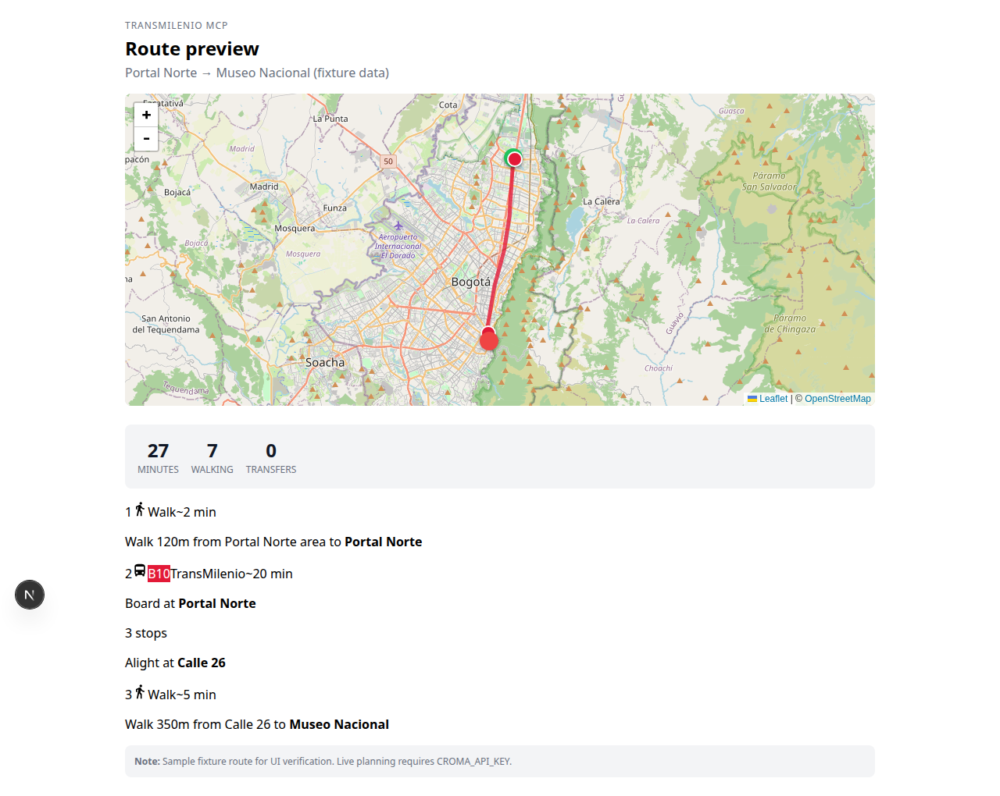

# TransMilenio MCP

An MCP server for calculating TransMilenio (Bogotá BRT + SITP buses) routes, exposed with interactive UI for AI clients.

[](LICENSE)

## What It Does

Connect this MCP server to Claude, ChatGPT, Cursor, or any MCP-compatible AI client. Ask about TransMilenio routes, and get:

- **Route planning** with step-by-step directions and an interactive map
- **Stop finding** by name, location, or route
- **Live arrivals** at any station
- **Service alerts** for delays and disruptions

The UI renders in hosts that support [MCP Apps](https://vercel.com/kb/guide/ai-sdk-mcp-apps).

## Demo

Route map UI rendered from fixture data (Portal Norte → Museo Nacional):



Local demo host: `pnpm dev` then open `/demo` (requires `OPENAI_API_KEY` and `CROMA_API_KEY`).

## Quickstart

### 1. Get a Croma API Key

This server uses the [Croma API](https://usecroma.com) for TransMilenio data.

1. Sign up at https://usecroma.com
2. Create an API key
3. Set the environment variable:

```bash
export CROMA_API_KEY=your_key_here
```

### 2. Install and Run

```bash
git clone https://github.com/LucasLeguizamo/transmilenio-router
cd transmilenio-router
pnpm install
pnpm network:sync   # local stop/route graph (gitignored; needs CROMA_API_KEY)
pnpm dev
```

The MCP server runs at `http://localhost:3000/api/mcp`.  
`plan_route` uses the synced network for search; Croma remains the source for live arrivals/alerts. See [docs/network-sync.md](docs/network-sync.md).

### 3. Connect to Your AI Client

#### Claude Desktop

Add to your Claude config (`~/Library/Application Support/Claude/claude_desktop_config.json`):

```json
{
  "mcpServers": {
    "transmilenio": {
      "command": "npx",
      "args": ["-y", "tsx", "/path/to/transmilenio-mcp/src/lib/mcp/server.ts"],
      "env": {
        "CROMA_API_KEY": "your_key_here"
      }
    }
  }
}
```

#### Cursor

Add to your Cursor MCP settings:

```json
{
  "transmilenio": {
    "url": "http://localhost:3000/api/mcp"
  }
}
```

#### Vercel AI SDK

```typescript
import { experimental_createMCPClient } from "ai";

const client = await experimental_createMCPClient({
  url: "http://localhost:3000/api/mcp",
});

const tools = await client.tools();
```

## Available Tools

| Tool | Description |
|------|-------------|
| `plan_route` | Plan a route between two locations with map and directions |
| `find_stops` | Find TransMilenio/SITP stops by name, location, or route |
| `stop_arrivals` | Get live arrival times at a stop |
| `service_alerts` | Get current service alerts and disruptions |

## Example Queries

- "Plan a route from Portal Norte to Museo Nacional"
- "Find TransMilenio stations near Calle 100"
- "When is the next bus at Portal Sur?"
- "Are there any service alerts on route B10?"

## Limitations

This project uses a simplified routing algorithm based on shared routes between stops. The Croma API provides stops, routes, and live data, but not full graph-based routing.

**Current limitations:**

- Route planning uses heuristics, not optimal pathfinding
- Text addresses resolve via stop name search (not full geocoding)
- Transfer routes are limited to one transfer
- Travel time estimates are approximations

For verified routes, check the official [TransMilenio website](https://www.transmilenio.gov.co).

## Development

```bash
# Install dependencies
pnpm install

# Run development server
pnpm dev

# Run verification
pnpm verify all

# Run tests
pnpm test

# Type check
pnpm typecheck

# Lint
pnpm lint
```

### Project Structure

```
├── src/
│   ├── lib/
│   │   ├── croma/      # Croma API client and types
│   │   ├── routing/    # Route planning algorithm
│   │   └── mcp/        # MCP server and tools
│   ├── ui/             # React UI components
│   └── app/            # Next.js pages and API routes
├── scripts/
│   └── verify.ts       # Verification CLI
├── tests/              # Test files and fixtures
├── docs/               # Documentation
└── .cursor/skills/     # Verification skill for agents
```

### Verification

This project includes a verification skill for AI agents:

```bash
# Health check
pnpm verify doctor

# Test MCP tools
pnpm verify mcp

# Local network snapshot integrity + plan_route latency
pnpm verify network

# Render and screenshot UI
pnpm verify ui

# Run all verifications
pnpm verify all
```

See `.cursor/skills/verify-transmilenio-mcp/` and [docs/network-sync.md](docs/network-sync.md).

## Contributing

See [CONTRIBUTING.md](CONTRIBUTING.md) for guidelines.

## License

MIT - see [LICENSE](LICENSE) for details.

## Acknowledgments

- [TransMilenio](https://www.transmilenio.gov.co) for the public transit system
- [Croma](https://usecroma.com) for the API
- [OpenStreetMap](https://www.openstreetmap.org) for map tiles
